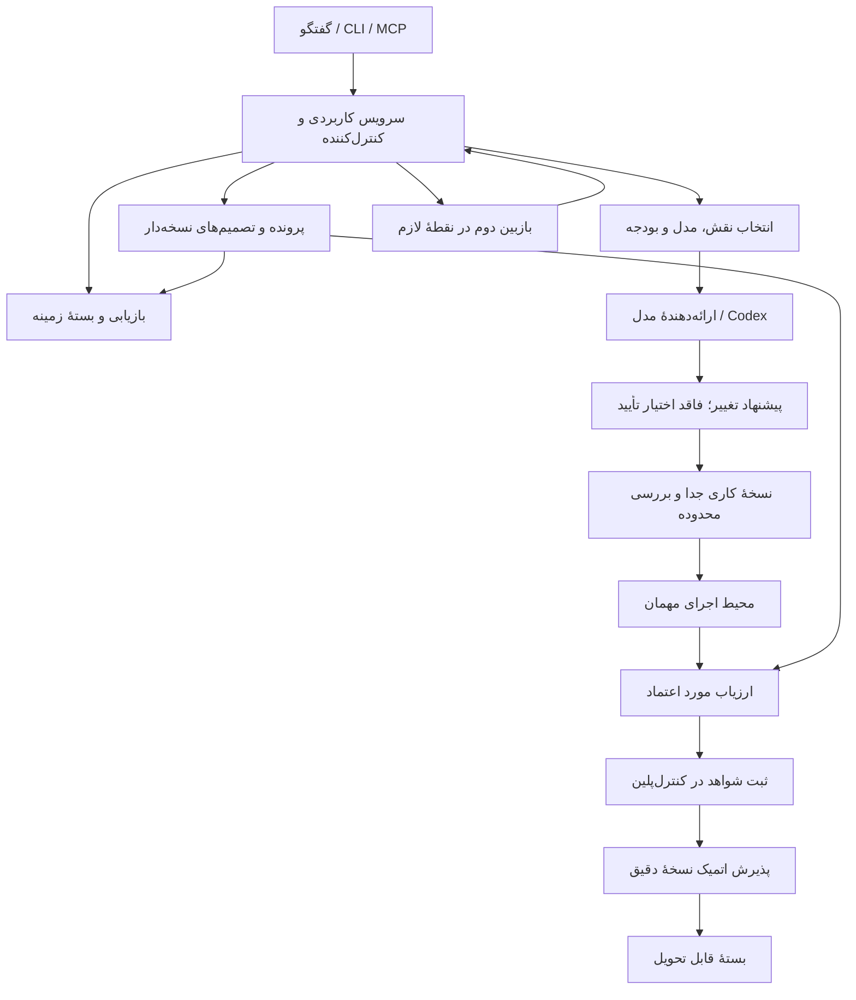

# نقشهٔ کامل ادامهٔ CSEF
نسخهٔ سند: ۰٫۱ — ۱۵ نوامبر ۲۰۲۶  
وضعیت: طرح اجرایی آینده؛ عبارت «برنامه‌ریزی‌شده» به معنی ساخته‌شدن نیست.

این سند هدف محصول، کدهای لازم، قرارداد اتصال‌ها، ترتیب توسعه، آزمایش‌ها و شروط تحویل را یک‌جا مشخص می‌کند. فایل‌های همراه:

- [فهرست ماژول‌ها و API هر مسئولیت](roadmap/MODULES.fa.md)
- [اتصال به مخزن‌ها، ابزارها و مدل‌ها](roadmap/INTEGRATIONS.fa.md)
- [کارهای اجرایی به ترتیب وابستگی](roadmap/BACKLOG.fa.md)
- [backlog قابل‌خواندن توسط ابزار](roadmap/backlog.json)
- [ماژول‌های هدف به صورت داده](roadmap/modules.json)
- [مخزن‌های بررسی‌شده و وضعیت انتخاب](roadmap/repositories.json)
- [هدف‌های ثبت‌شدهٔ صاحب پروژه](PROJECT-GOALS.json)
- [شواهد آزمایش انجام‌شده](evidence/handoff-screening-2026-11-15/summary.json)

## ۱. دقیقاً چه محصولی می‌سازیم؟

CSEF یک دستیار هدایت مهندسی و کنترل اجرای عامل موجود است. کاربر هدف را با زبان عادی می‌گوید؛ سیستم مجهول‌های مؤثر را می‌پرسد، تصمیم‌ها را ثبت می‌کند، کار را به مرحله و برش قابل‌تحویل تقسیم می‌کند، عامل مناسب را فراخوانی می‌کند و نتیجه را با شواهد می‌سنجد.

خروجی مطلوب: نرم‌افزار قابل استفاده، همراه با سابقهٔ تصمیم، کد، آزمون، دستور اجرا و محدودیت‌های روشن. تولید سند یا نمایش تعداد تست، جای این خروجی نیست.

اهداف پذیرفته‌شده:

| شناسه | هدف | چیزی که باید بسنجیم |
| --- | --- | --- |
| REQ-101 | هزینهٔ کمتر | مجموع مصرف سازنده، بازبین، اصلاح و زیرساخت؛ هزینهٔ معلوم و نامعلوم جدا |
| REQ-102 | در دسترس بودن | ادامهٔ پرونده بدون مدل، جابه‌جایی ارائه‌دهنده، بازیابی پس از اختلال |
| REQ-103 | سادگی | زمان فعال کاربر، سؤال ضروری، تکرار سؤال، نیاز به ترمینال |
| REQ-104 | حفظ هدف و تصمیم‌ها | انحراف هدف، نقض معماری، استفاده از نسخهٔ کهنه و تغییر بی‌صدا |
| REQ-105 | ساخت آسان‌تر پروژهٔ پیشرفته | تکمیل چند قابلیت وابسته، تغییر نیاز، مهاجرت داده و تحویل مستقل |
| REQ-106 | روش مهندسی منظم | ارتباط نیاز ← تصمیم ← کار ← کد ← معیار ← شاهد ← تحویل |
| REQ-107 | نظارت نقش دوم | خطای مفید کشف‌شده، هشدار بی‌مورد، هزینه و توقف اضافه |

هیچ درصد موفقیت عمومی یا مدت ساخت قطعی از دادهٔ فعلی به دست نمی‌آید.

## ۲. نقطهٔ شروع واقعی و فاصله با محصول

کد فعلی در `src/csef_gate/`، CLI در `csef.py` و نمونه‌ها در `examples/` هستند.

| بخش موجود | وضعیت واقعی | کار بعدی |
| --- | --- | --- |
| `project.py` | ProjectBook، هدف/پاسخ/نسخه، مراحل قابل تنظیم، تحویل، بستهٔ زمینه | منشأ دقیق داده و هماهنگی با اجرای واقعی در یک سرویس |
| `assistant.py` | پیش‌نویس نقش و پرسش تطبیقی، توقف تا پاسخ | اتصال پاسخ به نیاز/تصمیم متناظر؛ کیفیت و تکرار سؤال |
| `review.py` | سیاست ریسک و بازبینی نشست جدا | شدت/شاهد/اختلاف نظر و کنترل هزینه |
| `model_session.py` و بخش مدل در `backends.py` | دو مسیر مشابه فراخوانی Codex | یک آداپتر و یک قرارداد receipt |
| `core.py` | پیشنهاد محدود، اجرای ارزیاب، گزارش و پذیرش از رکورد کنترل | اتصال به lifecycle، شواهد کامل محیط و تراکنش واحد |
| `backends.py` | محدودیت بومی ویندوز و probes | مرز VM قابل‌سنجش برای اجرای عمومی |
| `project_cli.py` و `__main__.py` | فرمان‌های آزمایشی | API مشترک برای CLI، چت و در صورت نیاز UI |
| `experiments/handoffs/run.py` | مقایسهٔ محدود سه روش | corpus متنوع، تکرار و سنجش دخالت واقعی کاربر |

در آخرین اجرای ثبت‌شده ۱۳۳ آزمون مخزن موفق شدند. آزمایش سه روش روی یک CLI کوچک، بهبود کیفیت عمومی را ثابت نکرد: همه ۲۵ مشاهدهٔ مرحله‌ای را گذراندند. پروندهٔ فشرده ۸٫۶۸٪ ورودی کل و ۴٫۱۸٪ ورودی بدون کش کمتر داشت. بازبین هر مرحله ۵۲٫۸۵٪ ورودی بیشتر از پروندهٔ تنها داشت. این اعداد قیمت دلاری نیستند.

فاصله‌های مهم: کنترل‌کنندهٔ عمومی یکپارچه نداریم؛ اتصال چند ارائه‌دهنده و تجربهٔ واقعی کاربر سنجیده نشده؛ Git فعلی هنوز repository نیست؛ مرز شبکهٔ میزبان کامل نیست؛ مسیر انتشار نهایی بسته است. مخزن‌های SQLite فعلی ProjectBook و Gate جدا هستند و هماهنگی آن‌ها باید صریح و اتمیک طراحی شود.

کد `src/csef_contracts/` سابقهٔ آزمایش قراردادهاست. مجوزهای قابل ساختن آن منبع اختیار مسیر جدید نمی‌شوند. فقط بخش‌هایی که زیر آزمون منفیِ مستقل درست عمل کنند قابل استفادهٔ مجددند.

## ۳. تجربهٔ کاربر در محصول هدف

۱. کاربر در همین چت می‌گوید چه می‌خواهد.  
۲. سیستم هدف و گفته‌های صریح را ثبت می‌کند؛ فرض و پیشنهاد را جدا نشان می‌دهد.  
۳. حداکثر چند سؤال ضروری دربارهٔ کاربر، سناریو، نتیجه و محدودیت مؤثر می‌پرسد.  
۴. انتخاب‌های معمول مهندسی را با پیش‌فرض و دلیل پیش می‌برد؛ نام فریم‌ورک و پوشه‌بندی را بی‌دلیل از کاربر نمی‌پرسد.  
۵. نقشهٔ مراحل، اولین برش قابل استفاده، هزینهٔ قابل پیش‌بینی و مسائل باز را نشان می‌دهد.  
۶. پس از هر برش، خروجی واقعی و اختلاف با هدف دیده می‌شود.  
۷. تغییر خواسته با نسخه و اثر آن بر کار قبلی ثبت می‌شود.  
۸. کاربر پروژه، دستور اجرا و گزارش محدودیت‌ها را تحویل می‌گیرد.

در رابط عادی، JSON، command، شناسهٔ داخلی و stack trace پنهان می‌مانند؛ جزئیات فنی قابل بازکردن‌اند. سؤالِ «چه کسی داده را می‌بیند؟» ممکن است ضروری باشد؛ سؤالِ «کدام الگوی repository دوست داری؟» معمولاً تصمیم مهندسی است.

حالت همان چت اولویت دارد. رابط مستقل وب فقط وقتی ساخته می‌شود که اتصال چت، نیاز واقعی کاربر را پاسخ ندهد.

## ۴. معماری پیشنهادی و مرز اختیار



چهار رابط مستقل لازم است:

- `ModelProvider`: متن/JSON تولید می‌کند؛ فایل و shell یا تأیید پروژه در اختیارش نیست.
- `CodingAgent`: برای یک کار محدود پیشنهاد کد می‌دهد؛ ممکن است از ModelProvider یا CLI موجود استفاده کند.
- `ExecutionProvider`: محیط و فرمان مجاز را اجرا می‌کند؛ ادعای متنی مدل را به PASS تبدیل نمی‌کند.
- `Verifier/Controller`: خروج واقعی، نسخه، معیار و اختیار را بررسی و نتیجه را ثبت می‌کند.

LiteLLM یا Ollama جای محیط اجرای ایزوله نیستند. Docker جای ارزیاب نیست. Spec Kit به‌تنهایی منبع احراز اصالت شواهد CSEF نیست.

قاعدهٔ وابستگی: رابط‌ها ← سرویس کاربردی ← مدل دامنه/پورت‌ها. آداپترها پورت‌ها را پیاده می‌کنند. دامنه به CLI، وب، Codex یا VM وابسته نمی‌شود. جهت مجاز وابستگی با ابزار بررسی می‌شود.

## ۵. شش مرحلهٔ ساخت پروژهٔ کاربر

این شش مرحله با فازهای توسعهٔ خود CSEF در بخش ۱۴ فرق دارند. برای پروژهٔ کوچک ادغام و برای پروژهٔ پیچیده تکرار یا مرحلهٔ عملیات اضافه می‌شود.

| مرحله | ورودی | خروجی اصلی | کنترل عبور |
| --- | --- | --- | --- |
| شناخت | هدف، سناریو، محدودیت، پاسخ‌ها | brief، نیازها، خارج از محدوده، تعارض و معیار موفقیت | مجهول مسدودکننده حل یا صریح متوقف؛ نیاز ساخته‌شده به کاربر نسبت داده نشود |
| معماری | brief و محدودیت‌های معتبر | مرز مسئولیت، داده، NFR، ADR و گزینه‌های ردشده | سناریوی اصلی و خطر مهم پوشش داده شود؛ بازبین فقط شمارش واژه نکند |
| قرارداد و طرح | معماری و قابلیت‌های اولویت‌دار | ورودی/خروجی/خطا، schema، معیار و ترتیب برش‌ها | معیار آزمون‌پذیر و وابستگی هر کار روشن باشد |
| اولین مسیر کامل | قرارداد و محیط آماده | یک قابلیت از ورودی تا خروجی واقعی | اجرا، ذخیره/بازخوانی، خطا و معماری با شواهد سنجیده شوند |
| توسعه | نسخهٔ معتبر و تغییر محدود | قابلیت‌های بعدی، migration، تست و اسناد به‌روز | رفتار قبلی و داده حفظ شود؛ انحراف و دامنهٔ تغییر بررسی شود |
| تحویل | نسخهٔ کامل و شواهد | بسته، راهنما، lock، smoke، محدودیت و روش بازیابی | نصب/اجرای مستقل و gate انتشار؛ مدل حق خودتأییدی ندارد |

اسناد هر مرحله از جنس یکسان نیستند. وجود JSON صحیح یا ارجاع REQ به معنی معماری صحیح نیست. کیفیت معنایی طراحی با سناریو/مقایسه/بازبینی و در صورت نیاز نظر صاحب پروژه سنجیده می‌شود.

## ۶. بستهٔ استاندارد تحویل مرحله

حداقل فیلدها:

```text
project_id, stage_id, run_id, actor_role
project_revision, source_revision, parent_handoff_ids
accepted_requirement_ids, accepted_decision_ids
input_artifact_manifest, output_artifact_manifest
acceptance_bundle_hash, policy_hash, environment_fingerprint
executed_check_ids, check_outcomes, evidence_refs
open_questions, assumptions, risks, dissent
usage_refs, remaining_budget, next_stage_dependencies
status, created_at
```

وضعیت‌ها باید دو مفهوم را جدا نگه دارند: «آمادهٔ مرحلهٔ بعد» و «پذیرفته برای تحویل نهایی».

- lifecycle: `pending → ready → running → validating → ready_for_next`
- موارد توقف: `awaiting_owner, needs_revision, blocked, stale, cancelled`
- اجرای فرمان: `ok, failed, denied, unknown, timed_out`
- حکم ارزیاب: `pass, fail, review, stale, tamper_suspected`

مصرف‌کنندهٔ بعدی هش artifact را از بایت واقعی دوباره بررسی می‌کند. summary یا واژهٔ passed در سند، پیش‌شرط عبور نیست. نتیجهٔ قدیمی با تغییر کد، معیار، سیاست یا محیط، به‌طور متناسب stale می‌شود.

## ۷. قرارداد کد بین ماژول‌ها

این امضاها طراحی هدف‌اند، نه API ساخته‌شدهٔ فعلی:

```python
class ModelProvider(Protocol):
    def capabilities(self) -> ModelCapabilities: ...
    def generate(self, request: ModelRequest) -> ModelResult: ...
    def cancel(self, call_id: str) -> CancelOutcome: ...

class CodingAgent(Protocol):
    def propose(self, task: TaskPacket, base: SourceSnapshot) -> ChangeProposal: ...

class ExecutionProvider(Protocol):
    def provision(self, profile: ExecutionProfile) -> EnvironmentHandle: ...
    def execute(self, handle: EnvironmentHandle, request: ExecutionRequest) -> ExecutionReceipt: ...
    def collect(self, handle: EnvironmentHandle, manifest: OutputAllowlist) -> ArtifactBundle: ...
    def destroy(self, handle: EnvironmentHandle) -> CleanupReceipt: ...

class ProjectService(Protocol):
    def receive_message(self, project_id: str, message: OwnerMessage) -> ConversationResult: ...
    def prepare_stage(self, project_id: str, stage_id: str) -> TaskPacket: ...
    def apply_owner_change(self, project_id: str, change: OwnerChange) -> ChangeImpact: ...

class VerificationService(Protocol):
    def evaluate(self, request: VerificationRequest) -> VerificationRecord: ...
    def promote(self, run_id: str, expected_revision: str) -> Checkpoint: ...
```

ModelRequest شامل role، prompt/schema، context manifest، capability لازم، مهلت و سقف خروجی است. ModelResult شامل شناسهٔ واقعی مسیر/مدل در صورت گزارش، usage، خطا و artifact است. متن مدل هیچ فیلد اختیاری برای مجوز انتشار ندارد.

ChangeProposal باید base revision، عملیات فایل، دلیل، شناسهٔ نیاز، محدوده و manifest داشته باشد. full replacement برای فایل کوچک حفظ می‌شود؛ diff برای پروژهٔ بزرگ فقط با بررسی نسخه و parser مطمئن پذیرفته می‌شود. proposal خارجی با همان بررسی‌ها import می‌شود.

ExecutionReceipt از مسیر کنترل‌کننده ثبت می‌شود و شامل command spec، source manifest، نتیجهٔ فرایند، hash خروجی، truncation، محیط و زمان است. شناسهٔ محیط و «producer=harness» به‌تنهایی احراز منشأ نیستند.

## ۸. پایگاه داده و وضعیت پایدار

برای نسخهٔ شخصی، SQLite و مخزن محتوایی فایل کافی است. PostgreSQL، Redis و صف توزیع‌شده پیش‌نیاز نیستند. یک DB اختیار کنترل و چند repository منطقی داخل آن، از تراکنش بین دو DB مستقل ساده‌تر است.

| جدول/مخزن | دادهٔ کلیدی |
| --- | --- |
| projects / project_revisions | هدف، نسخه، actor و منشأ تغییر |
| requirements / requirement_revisions | گفتهٔ کاربر، فرض، پیشنهاد، پذیرش و supersede |
| decisions | مسئله، گزینه، دلیل، authority و نیازهای مرتبط |
| questions / answers | دلیل ضرورت، پاسخ، ویرایش، نیاز/تصمیم متأثر |
| stages / stage_dependencies | ورودی، پیش‌شرط، وضعیت و نسخهٔ معتبر |
| proposals | نسخهٔ پایه، عملیات فایل، scope و manifest |
| artifacts | content hash، اندازه، نوع، path خصوصی و provenance |
| model_calls | intent قبل از تماس، مسیر مدل، outcome، usage و unknown |
| budget_reservations | برآورد، سقف، تسویهٔ یک‌باره و قیمت نسخه‌دار |
| executions | فرمان مجاز، محیط، intent، نتیجه و خروجی |
| verification_records | اتصال کامل نیاز/کد/معیار/سیاست/محیط/شواهد |
| checkpoints | شناسهٔ یکتا، رکورد تأیید و source دقیق |
| approvals | actor، scope، عمل، مقصد، digest و انقضا در صورت نیاز |
| events | رویدادهای ترتیبی و قابل بازسازی |
| leases | مالک اجرای پروژه/مرحله و کنترل هم‌زمانی |
| search_index / FTS | index قابل بازسازی؛ فاقد اختیار تأیید |

کلید خارجی، uniqueness، تراکنش کوتاه و serialization نسخه‌دار لازم است. artifactها خارج از DB با hash ثبت می‌شوند؛ کلید و توکن در این جدول‌ها ذخیره نمی‌شوند. backup باید DB و artifactهای متناظر را با manifest و آزمون restore نگه دارد.

ثبت intent پیش از اثر و ثبت outcome پس از آن ضروری است. تراکنش SQLite دور یک API خارجی، exactly-once نمی‌سازد؛ وضعیت unknown نیازمند reconciliation یا توقف است.

## ۹. حافظهٔ پروژه، بازیابی و کنترل فراموشی

زنجیرهٔ لازم:

۱. گفته و تصمیم معتبر با شناسه و منشأ ثبت شود.  
۲. کد و سند با digest نسخه‌دار index شوند.  
۳. برای کار جاری فایل/نماد/آزمون و اسناد مرتبط بازیابی شوند.  
۴. هدف و محدودیت حیاتی همیشه داخل بسته باشند.  
۵. summary فقط cache باشد و به منبع قابل بازگشت پیوند بخورد.  
۶. stale بودن سند و summary پس از تغییر شناخته شود.  
۷. خروجی با trace و آزمون مستقل بررسی شود.

ابتدا Python ast، جستجوی متن و SQLite FTS5؛ tree-sitter پس از نیاز چندزبانه؛ embedding و vector DB فقط پس از سنجش شکست بازیابی ساده. بودجهٔ context باید موارد حذف‌شده را نشان دهد، نه اینکه محدودیت حیاتی را بی‌صدا ببرد.

«هدف در DB هست» مساوی «مدل هدف را رعایت کرده» نیست. اولی با ذخیره و hash قابل بررسی است؛ دومی به نتیجهٔ واقعی، بررسی معنایی و سناریوهای منفی نیاز دارد.

## ۱۰. ارائه‌دهنده، هزینه و دسترس‌پذیری

ترتیب انتخاب:

۱. مسیر Codex موجود را تثبیت و دو پیاده‌سازی مشابه مدل را یکی کنیم.  
۲. ModelProvider مستقیم با SDK رسمی و endpoint صریح اضافه کنیم.  
۳. AvalAI یا مسیر سازگار فقط پس از آزمون capabilities همان مدل فعال شود.  
۴. Ollama محلی برای نقش مناسب با سخت‌افزار و مدل موجود آزمایش شود.  
۵. LiteLLM فقط وقتی چنددرگاهی/نگهداری، سود واقعی آن را نشان داد اضافه شود.

درگاه متن با عامل کدنویسی متفاوت است. پشتیبانی Chat Completions، سازگاری کامل عامل متکی به Responses را ثابت نمی‌کند. فهرست نام مدل‌ها جای probe نیست. قیمت، context، schema، usage، لغو و سقف خروجی هر مسیر ثبت می‌شوند.

AvalAI endpoint مستند `https://api.avalai.ir/v1` دارد؛ [راهنمای رسمی](https://docs.avalai.org/en/api-reference/introduction) و [ملاحظات Codex](https://docs.avalai.org/en/guides/setup-codex) مبنای آزمون‌اند. هیچ کلید فعلی در این سند لازم نیست.

قاعدهٔ هزینه:

- پیش از تماس، intent و رزرو سقف قابل محاسبه ثبت شود.
- cached input، uncached input، output، زمان و هزینهٔ اشتراک با هم یکی فرض نشوند.
- هزینهٔ ناشناخته صفر نشود؛ reservation نامعلوم خودکار آزاد نشود.
- تا وقتی نرخ و سقف معتبر نیست، «بودجهٔ دلاری تضمینی» ادعا نشود.
- سقف محلی باید با قابلیت واقعی provider و در صورت لزوم سقف حساب نزد provider پشتیبانی شود.
- fallback فقط به مسیر دارای قابلیت و سیاست دادهٔ مجاز برود؛ هزینهٔ بیشتر یا ارسال دادهٔ حساس به مقصد جدید بی‌صدا نباشد.
- مدل محلی رایگان فرض نشود: حافظه، برق، زمان و افت کیفیت هم اندازه‌گیری می‌شوند.

حالت اختلال: مطالعه/پاسخ/ویرایش پرونده بدون مدل ادامه یابد؛ تماس قطع‌شده unknown ثبت شود؛ کار تکراری و عملیات خارجی دوباره خودکار انجام نشوند. صف «منتظر مدل» از «هدف نامعلوم» جدا باشد.

## ۱۱. Git، مخزن‌های هدف و بستهٔ کد

دو نوع اتصال داریم:

- استفاده از ابزار متن‌باز، مانند Codex یا Spec Kit؛ فهرست در annex اتصال‌هاست.
- کار روی repository انتخاب‌شدهٔ خود کاربر؛ این repository داده و مقصد کار است، نه وابستگی CSEF.

مسیر مخزن هدف: انتخاب صریح local path یا remote مجاز، ثبت وضعیت dirty، snapshot مبنا، worktree/candidate مستقل، پیشنهاد محدود، بررسی، خروجی قابل مرور و در صورت مجوز صریح branch/PR. خود پوشهٔ فعلی CSEF در بررسی امروز Git repository نبود؛ تثبیت تاریخچه اولین کار است.

کنترل‌های لازم: حفظ تغییرات قبلی کاربر؛ عدم اجرای hook یا submodule ناشناخته؛ عدم جمع‌آوری فایل‌های secret یا دادهٔ واقعی به context؛ مالکیت روشن branch/worktree؛ rollback محدود؛ تطبیق commit/tree با شواهد. نوشتن در GitHub، merge و deploy سیاست جدا دارند.

در v1 استفاده از git CLI به‌جای بازسازی Git کافی است. GitHub read-only بعد از آن؛ PR draft فقط روی مقصد و تغییر مشخصِ مجاز. یک تغییر diff یا مقصد، مجوز قبلیِ وابسته به همان digest را معتبر نگه نمی‌دارد.

## ۱۲. محیط اجرا و بستن مانع فعلی امنیت

واقعیت فعلی: profile بومی ویندوز در آزمایش فایل‌های کنترل را محافظت کرد ولی loopback میزبان در دسترس بود. این مانع با تغییر نام verdict یا نادیده‌گرفتن probe بسته نمی‌شود.

پیشنهاد اجرایی: Linux guest اختصاصی روی Hyper-V این میزبان، در صورت تأیید قابلیت و منابع. [مستند رسمی Hyper-V](https://learn.microsoft.com/en-us/windows-server/virtualization/hyper-v/get-started/Install-Hyper-V). ایجاد/نصب/تغییر hypervisor در این کارِ مستندسازی انجام نشده است.

- میزبان کنترل‌کننده، secrets، DB و مجوز پذیرش را نگه می‌دارد.
- مهمان فقط نسخهٔ کد، بستهٔ آزمون مجاز و scratch می‌گیرد.
- هیچ mount مستقیم از پوشهٔ کنترل، پروفایل کاربر یا docker.sock میزبان وجود ندارد.
- کانال مدیریتی محدود، manifest محتوا، محدودیت اندازه و مسیر allowlist دارد.
- Docker درون VM در صورت نیاز ابزار محیط است؛ مرز مستقل میزبان، VM است.
- دریافت dependency در گام آماده‌سازی با مقصدهای صریح؛ گام اجرا مطابق profile شبکهٔ لازم را دارد.
- loopback داخلی مهمان برای برنامهٔ وب می‌تواند مجاز باشد؛ این به معنی دسترسی به loopback و سرویس میزبان نیست.
- CPU، memory، زمان، فضای دیسک، output و process tree مهار و بررسی می‌شوند.
- قطع کانال، mismatch manifest یا خروجی ناقص، unknown/fail است.
- بازسازی/reset محیط باید با fingerprint و آزمون ادامه قابل تکرار باشد.

اثبات لازم: positive control برای دسترسی‌های لازم و negative control برای host files، host services، metadata endpoints، خروج از scope، تغییر baseline، منابع و مسیر برگشت artifact. این مجموعه هم ادعای نبود همهٔ آسیب‌پذیری‌ها نیست.

## ۱۳. ارزیابی، بازبین و انتشار

سه لایه مکمل‌اند:

۱. کنترل مکانیکی: schema، scope، source/base hash، وابستگی، بودجه، تازگی و provenance.  
۲. آزمون اجرا: رفتار، رگرسیون، دادهٔ قدیمی، نصب، migration و recovery.  
۳. بررسی معنایی: حفظ هدف، مناسب‌بودن معماری، کیفیت سناریو و ابهام کسب‌وکار.

Python pack: pytest، Ruff و mypy با پیکربندی مرتبط. Web pack: build و Playwright در guest. اسرار و آسیب‌پذیری شناخته‌شده با Gitleaks و pip-audit بررسی شوند؛ نتیجهٔ پاک آن‌ها ممیزی کامل امنیت نیست.

بازبین مدل در معماری/قرارداد، تغییر هدف، migration، مرز امنیت، تغییر بزرگ و شکست تکراری فراخوانی می‌شود. حالت always قابل انتخاب می‌ماند. finding باید fact/فایل/شاهد و پیشنهاد بررسی داشته باشد. اختلاف دو مدل با رأی‌گیری ساده حل نمی‌شود؛ مدرک، نمونهٔ ضد و در موارد تجاری سؤال صاحب پروژه لازم است.

پذیرش نهایی از رکورد جاری کنترل‌کننده می‌آید: تمام معیارهای اجباری outcome دارند، artifact و کد و baseline و محیط و policy یکی‌اند، نتیجه unknown یا ناقص نیست، مجوز لازم درست مصرف شده و commit مشخص است. مدل یا plugin نمی‌تواند PASS ورودی بدهد و انتشار بگیرد.

بستهٔ تحویل: کد/commit، lock و محیط لازم، راهنمای نصب/اجرا، smoke test، گزارش معیارها، محدودیت‌ها، روش backup/restore و نسخهٔ قبلی. انتشار نرم‌افزار خود CSEF با استقرار برنامهٔ ساخته‌شده یکی نیست؛ هرکدام معیار خود را دارند.

## ۱۴. فازهای توسعهٔ خود CSEF

| فاز | کارها | نتیجهٔ لازم برای خروج |
| --- | --- | --- |
| F0 تثبیت و reuse | T001–T002 | خط مبنا و تصمیم مستند دربارهٔ استفادهٔ محدود از Spec Kit |
| F1 هستهٔ یکپارچه | T003–T008 | پرونده، سؤال، اجرا، تحویل و ادامه از یک سرویس و یک مرجع وضعیت |
| F2 مهندسی و زمینه | T009–T012 | سناریو، معماری و کار مرتبط با هدف؛ بازیابی قابل بازگشت |
| F3 مدل و هزینه | T013–T017 | Codex پایدار، یک مسیر API جایگزین سنجیده و هزینه/unknown روشن |
| F4 تغییر و Git | T018–T020 | پیشنهاد نسخه‌بسته، worktree امن و اثر تغییر |
| F5 اجرای واقعی | T021–T024 | مرز محیطِ سنجیده و خروجی محدود؛ بسته‌شدن مانع فعلی |
| F6 ارزیابی و اختیار | T025–T028 | حکم مستقل و پذیرش اتمیک با تست‌های منفی |
| F7 دسترسی کاربر | T029–T031 | کار از چت؛ UI و عملیات remote فقط با نیاز و scope |
| F8 تحویل و خانواده‌های بعدی | T032–T034 | بستهٔ قابل نصب، restore و نمونهٔ API/وب سنجیده |
| F9 اثبات و انتشار | T035–T036 | مقایسهٔ منصفانه، تجربهٔ کاربر و بستهٔ انتشار معتبر |
| بعداً | T037–T038 | LiteLLM/OpenHands/tree-sitter فقط با فایدهٔ اندازه‌گیری‌شده |

وابستگی taskها از شمارهٔ ظاهری مهم‌تر است؛ جزئیات در backlog آمده. «۷۵ مسئولیت فایل در نقشه» دستور ساخت ۷۵ فایل خالی نیست. تا وقتی جداسازی لازم نشود، مسئولیت کوچک می‌تواند در فایل فعلی بماند. facadeهای فعلی برای سازگاری حفظ می‌شوند و هر انتقال با آزمون رفتار انجام می‌شود.

اولین milestone مفید: یک پروژهٔ محدود از پیام طبیعی تا سؤال ضروری، نسخهٔ هدف، طرح، اولین قابلیت و گزارش مشاهده‌شده، با توقف/ادامه و بدون دستکاری دستی DB. رابط پرزرق‌وبرق یا چندین agent backend شرط این milestone نیست.

## ۱۵. API چت و داده‌های کاربر

عملیات پیشنهادی در application service و MCP، با شکل یکسان:

| عملیات | ورودی مهم | خروجی مهم |
| --- | --- | --- |
| project_create | پیام هدف، محدودیت و scope | project_id، برداشت اولیه و مجهول‌ها |
| project_message | project_id، پیام و revision مورد انتظار | پاسخ، پیشنهاد تغییر یا سؤال |
| questions_get / question_answer | question_id و پاسخ | نسخهٔ جدید و اثر تغییر |
| plan_get / context_get | project_id، stage و فایل‌های مرتبط | مرحله‌ها و بستهٔ زمینه با manifest |
| stage_run / run_status / run_cancel | stage و expected revision | run_id، پیشرفت، outcome و مصرف |
| proposal_get | proposal_id | diff، scope و اثر تغییر |
| review_get | review_id | finding، شاهد و سؤال ضروری |
| verification_get | verification_id | معیارهای اجراشده، outcome و محدودیت |
| deliverable_get | artifact_id | فایل مجاز، manifest و راهنمای استفاده |
| release_request | run_id، مقصد و digest | نتیجهٔ gate یا نیاز به اختیار مشخص |

tool عمومیِ اجرای shell یا خواندن path دلخواه ارائه نمی‌شود. همهٔ عملیات schema، scope، actor و نسخه را کنترل می‌کنند. annotation ابزار MCP به‌تنهایی مجوز نیست. پشتیبانی میزبان از transport/احراز هویت/فایل باید در همان نسخهٔ واقعی آزمایش شود؛ اتصال به همهٔ چت‌بات‌ها وعده داده نمی‌شود.

اگر API/UI محلی لازم شد، همان سرویس استفاده شود؛ منطق دومِ پذیرش داخل وب نوشته نشود. local-only بودن جای token/session و بررسی origin را نمی‌گیرد.

## ۱۶. تنظیمات و نسخه‌ها

خانوادهٔ تنظیمات لازم:

- `project`: نوع محصول، زبان، scope، نیاز، تصمیم و حدود داده.
- `workflow`: stage graph، precondition، خروجی و نقش.
- `providers`: endpoint، model id/snapshot، capability و secret reference.
- `budgets`: سقف تماس، retry، مهلت و سقف پولی فقط با نرخ معتبر.
- `execution`: backend، image digest، filesystem، network و resource.
- `verification`: معیار اجباری، ابزار، target، parser و نوع شاهد.
- `review`: نقاط ریسک، آستانهٔ تغییر و حالت always.
- `retention`: نگهداری/حذف artifact، prompt و خروجی.
- `release`: مقصدهای مجاز و شروط نشر.

صرف نوشتن config اجرای policy نیست؛ هر فیلد باید مصرف‌کننده و آزمون منفی داشته باشد. تنظیم ناشناختهٔ مؤثر رد می‌شود. نسخهٔ SDK، CLI، workflow، قالب، prompt و parser بعد از آزمون قفل می‌شود؛ HEAD مشاهده‌شده در فایل مخزن‌ها lock آمادهٔ استفاده نیست.

## ۱۷. شکست و بازیابی

| رخداد | رفتار لازم |
| --- | --- |
| تعارض نیاز | سؤال ضروری؛ بدون تغییر بی‌صدای facts |
| پاسخ به نسخهٔ قدیمی | رد و بازسازی packet جاری |
| provider قطع/کند | timeout، outcome نامعلوم، budget محفوظ و fallback مجاز |
| schema مدل نامعتبر | عدم اعمال؛ retry محدود فقط با سیاست ثبت‌شده |
| patch خارج از scope | رد پیش از نوشتن |
| dependency ناشناخته | توقف نصب؛ مسیر مجاز و lock لازم |
| آزمون خالی یا گزارش مبهم | REVIEW/FAIL؛ نبود شاهد PASS نیست |
| نتیجهٔ خارجی نامعلوم | reconciliation؛ عدم تکرار خودکار non-idempotent |
| تغییر baseline/کنترل | tamper_suspected و توقف |
| خرابی DB/artifact | توقف پذیرش؛ restore از backup آزموده |
| دو کنترل‌کننده | lease/transaction؛ فقط یک اثر معتبر |
| هستهٔ قدیمی ناسازگار | حفظ سازگاری خواندن؛ عدم واردکردن اختیار قدیمی |

## ۱۸. سنجش ارزش قبل از گسترش

سناریوهای هدف: CLI با legacy data؛ API با نقش و مجوز؛ وب با مسیر کاربر؛ تغییر نیاز در میانه؛ resume پس از قطع؛ فایل گمراه‌کننده و انحراف هدف. اندازهٔ واقعی، محدودیت و هزینهٔ هر سناریو قبل از اجرا نوشته شود.

مقایسهٔ اصلی: عامل مستقیم با همان اطلاعات/ابزار/محیط/بودجه در برابر CSEF با بازبین هدفمند. تاریخچهٔ خام تنها baseline ممکن نیست. معیار نهایی باید جدا از حلقهٔ اصلاح باشد و کارها با تکرار جفتی، ترتیب جابه‌جا و نسخه‌های ثابت سنجیده شوند.

سنجه‌ها: نتیجهٔ نهایی، باگ پس از اعلام تکمیل، حفظ داده، نقض هدف، زمان فعال کاربر، سؤال غیرضروری، توقف اشتباه، هزینهٔ معلوم/نامعلوم و زمان کل. درصد پوشش، تعداد سند و تعداد خط کد به‌تنهایی ارزش محصول نیستند.

سقف هزینهٔ خود آزمایش و معیار تصمیم ادامه/توقف باید پیش از آزمایش مشخص شوند. دادهٔ منفی هم حفظ شود. آستانهٔ اقتصادی بر اساس ارزش کاربر تعیین می‌شود؛ این سند عدد ساختگی برای سود یا مدت پروژه نمی‌سازد.

## ۱۹. موارد خارج از نسخهٔ اول

چندعاملی هم‌زمان برای هر کار، vector DB اجباری، Kubernetes، صف توزیع‌شده، آموزش مدل، IDE اختصاصی، همهٔ زبان‌ها، همهٔ سرویس‌های Git، marketplace عمومی، استقرار خودکار پولی و چندمستاجری، شرط ساخت مسیر اول نیستند.

توسعهٔ هرکدام نیازمند مسئله، گزینهٔ ساده‌تر، معیار ارزش و task جدید است. اتصال به پروژهٔ شخصی دیگر کاربر هم از نام و سابقه حدس زده نمی‌شود؛ repository هدف باید مشخص باشد.

## ۲۰. تعریف پایان نسخهٔ قابل استفاده

- کاربر از چت یک پروژهٔ هدف پشتیبانی‌شده را شروع و بدون پرکردن فایل فنی جلو ببرد.
- هدف، پاسخ و تصمیم به نسخه و کد و شواهد وصل بمانند.
- یک تغییر نیاز، یک migration و یک قطع/ادامه واقعاً آزمایش شوند.
- یک مسیر جایگزین مدل با سیاست و قابلیت روشن کار کند؛ ذخیرهٔ پرونده به شبکه وابسته نباشد.
- محدودیت اجرای مورد ادعا در محیط هدف مشاهده و تأیید شود.
- پذیرش بدون اجرای معتبر، با replay یا نسخهٔ متفاوت ممکن نباشد.
- بسته در محیط تمیز نصب و اجرا شود و backup قابل restore باشد.
- نتیجهٔ مقایسه، هزینه و محدودیت بدون ادعای برتریِ اثبات‌نشده منتشر شود.
- انتخاب مجوز خود پروژه، مجوز اجزای بازاستفاده‌شده و نسخه‌های قفل‌شده پیش از انتشار روشن باشند.

این کار فعلاً نقشه و backlog می‌سازد. هیچ کتابخانه‌ای نصب، هیچ VM ساخته، هیچ remote تغییر و هیچ ادعای اجرای اتصال‌های برنامه‌ریزی‌شده ثبت نشده است.
